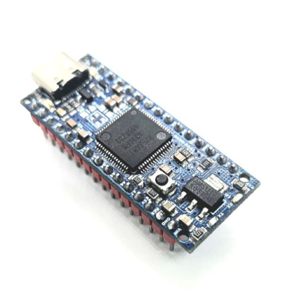

# NANOR4ST - Plataforma de Hardware para TBLACKSBOT

Finalizando os testes em nossa **NANOR4ST**: A Plataforma de Hardware otimizada e específica para a **TBLACKSBOT**. Na **SiriNEO Technologies**, desenvolvemos a #NANOR4ST como uma solução dedicada para potencializar ao máximo nossa Plataforma de Hardware Robótica TBLACKSBOT.

Essa adaptação utiliza o microcontrolador **Renesas RA4M1** da Renesas Semiconductor (#RA4M1) (ARM Cortex-M4) para atender demandas específicas de desempenho, precisão e confiabilidade em nosso equipamento.

<!-- CÓDIGO PARA CENTRALIZAR A IMAGEM -->

  

---

## 🔍 Por que o RA4M1 na NANOR4ST?

Selecionamos este microcontrolador por suas características técnicas alinhadas às necessidades da #TBLACKSBOT:

1.  **Oscilador interno de alta precisão (HOCO):** Elimina componentes externos e garante clock estável, crucial para movimentos robóticos precisos.
2.  **Detecção de toque capacitiva (CTSU):** Permite interfaces intuitivas para interação humano-robô.
3.  **USB 2.0 Full-Speed (USBFS):** Facilita a comunicação com sistemas externos e atualizações de firmware.
4.  **ADC de 14 bits e DAC de 12 bits:** Garantem leitura e controle analógico refinados para sensores e atuadores.
5.  **Amplificador operacional (OPAMP) integrado:** Simplifica circuitos de condicionamento de sinal em sensores robóticos.
6.  **Memória:** 256 KB Flash, 32 KB RAM.
7.  **Velocidade do clock:** 48 MHz.

---

## ⚙️ Comunicação Robusta para Aplicações Robóticas

A NANOR4ST foi montada para oferecer conectividade flexível e confiável:

-   **UART (D0/D1):** Comunicação serial com módulos externos.
-   **SPI (D10-D13/ICSP):** Ideal para sensores de alta velocidade e displays.
-   **I2C (A4/A5):** Conexão simplificada para múltiplos periféricos.
-   **CAN (D4/D5):** Suporte a redes industriais (com transceptor externo).

---

## 🎯 Foco na TBLACKSBOT!

Nossa NANOR4ST foi pensada para:

1.  Otimizar custos sem sacrificar desempenho.
2.  Reduzir complexidade com periféricos integrados.
3.  Garantir confiabilidade em operações contínuas.

---

## 📊 Especificações Técnicas Detalhadas (RA4M1)

Nossa versão da #ARDUINONANOR4 é a **#NANOR4ST** (#RA4M1 R7FA4M1AB3CNB).

### Principais características do HOCO no Renesas RA4M1:

| Característica | Detalhe |
| :--- | :--- |
| **Frequência Configurável** | Tipicamente 8, 12, 16, 20, 24, 32, 40, 48 MHz. |
| **Precisão** | Menor que cristal: ~±1% a ±3% dependendo da calibração. |
| **Estabilidade Térmica** | Moderada: pode variar com temperatura, mas aceitável. |
| **Pronto para uso** | Sim, inicializado rapidamente na partida (boot). |
| **Custo** | Zero, pois está integrado ao chip. |
| **Ideal para** | Aplicações gerais: I/O, PWM, UART, SPI, etc. |
| **Não ideal para** | Aplicações que exigem precisão extrema, como USB Full-Speed. |

### Recursos Adicionais:

-   **Detecção de toque:** Unidade de detecção de toque capacitiva (CTSU).
-   **Módulo USB:** Módulo USB 2.0 de velocidade máxima (USBFS).
-   **ADC:** Resolução de até 14 bits.
-   **DAC:** Resolução de até 12 bits.
-   **Recurso adicional:** Amplificador operacional (OPAMP).

---

## 🔗 Referências e Links Úteis

-   [Análise técnica da plataforma (Technoblogy)](http://www.technoblogy.com/show?4JVF)
-   [Datasheet do Renesas RA4M1 (Mouser)](https://www.mouser.com/datasheet/2/698/r01ds0355ej0110_ra4m1-1999414.pdf)
